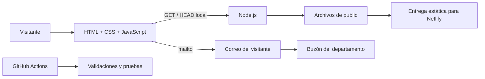
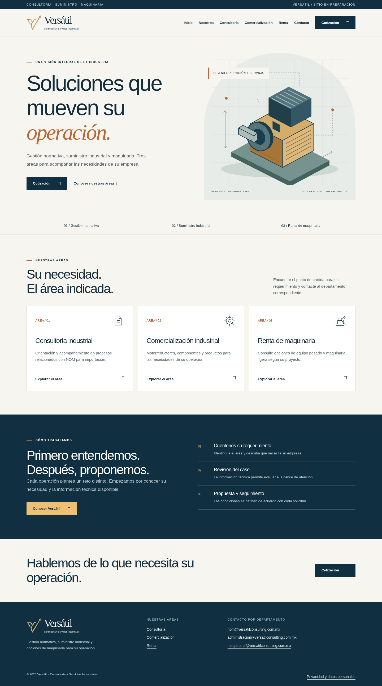

# Consultoría y Servicios Industriales Versátil

**Versátil** integra consultoría relacionada con NOM para importación, comercialización industrial y renta de maquinaria. Este repositorio contiene el sitio corporativo, su diseño aprobado, el código del frontend y del servidor Node.js, las pruebas y la documentación de la empresa y del producto web.

La denominación aportada para el proyecto es **Consultoría y Servicios Industriales Versátil, S.A. de C.V.** Los datos corporativos y comerciales pendientes de respaldo se distinguen en la documentación y no se publican como hechos confirmados.

## Tres áreas, una presentación corporativa

| Área | Qué presenta la página | Correo oficial |
| --- | --- | --- |
| Consultoría / NOM | Orientación y acompañamiento para revisar casos relacionados con NOM para importación. | [nom@versatilconsulting.com.mx](mailto:nom@versatilconsulting.com.mx) |
| Comercialización industrial | Motorreductores y productos industriales. | [administracion@versatilconsulting.com.mx](mailto:administracion@versatilconsulting.com.mx) |
| Renta de maquinaria | Consulta de equipo pesado y maquinaria ligera según el requerimiento. | [maquinaria@versatilconsulting.com.mx](mailto:maquinaria@versatilconsulting.com.mx) |

**El correo electrónico es el único medio de contacto.** Las páginas muestran las direcciones completas y enlaces mailto; el visitante redacta y envía desde su propia cuenta. El sitio no contiene formularios, teléfono, WhatsApp ni envío SMTP y no necesita contraseñas de Google.

## Sitio público

[Ver la página de prueba de Versátil en Netlify](https://frolicking-kleicha-53d5d3.netlify.app/).

La publicación estática y la ejecución local usan el mismo frontend. El enlace de prueba no sustituye la revisión pendiente del texto completo del aviso de privacidad ni la confirmación del contenido corporativo antes de una publicación definitiva.

## Documentación completa

| Documento | Alcance |
| --- | --- |
| [Quién es Versátil](docs/EMPRESA.md) | Identidad, oferta, públicos y política de contacto. |
| [Arquitectura](docs/ARQUITECTURA.md) | Frontend, servidor, flujo de correo, construcción y pruebas. |
| [Diseño](docs/DISENO.md) | V aprobada, tipografía, colores, componentes, responsive y animaciones. |
| [Esquema de páginas](docs/ESQUEMA_DEL_SITIO.md) | Mapa de información, diez rutas, bloques y navegación. |
| [Desarrollo y publicación](docs/DESPLIEGUE.md) | VS Code, localhost, Netlify y estructura correcta de la entrega. |
| [Contacto y cotización](docs/CONFIGURAR_COTIZACIONES.md) | Funcionamiento exclusivamente por correo. |
| [Auditoría estricta](docs/AUDITORIA_ESTRICTA.md) | Hallazgos corregidos, comprobaciones realizadas y límites. |
| [Estado del proyecto](docs/ESTADO_DEL_PROYECTO.md) | Funciones implementadas y pendientes. |
| [Índice de documentación](docs/README.md) | Acceso a todas las especificaciones. |

El PDF original de referencia está marcado para uso interno y no se publica en este repositorio. Las especificaciones versionadas reflejan las decisiones vigentes del usuario.

## Arquitectura



El frontend usa HTML, CSS y JavaScript nativos. El servidor Node.js utiliza módulos nativos y no tiene dependencias de producción. La versión estática para Netlify funciona sin un proceso Node.js en el alojamiento. Las herramientas de desarrollo se emplean para validar HTML, accesibilidad y comportamiento.

No existe una API de recepción de cotizaciones, base de datos o bandeja administrativa. `GET /api/health` describe el servidor local con `{ "status": "ok", "contact": "email" }`.

## Diseño aprobado

- V dorada con flecha ascendente y fondo transparente, junto a Versátil en tipografía serif.
- Composición azul marino y fondo claro, con acentos cálidos y dorados.
- Ilustración industrial conceptual, tarjetas de áreas y jerarquía técnica legible.
- Entradas discretas al desplazarse, respuesta de tarjetas y botones y menú móvil accesible.
- Movimiento reducido respetado y navegación disponible sin JavaScript.

La descripción exacta de paleta, fuentes y tiempos está en [DISENO.md](docs/DISENO.md).

<details>
<summary>Ver capturas de la publicación en escritorio y móvil</summary>

[Vista de escritorio](docs/assets/inicio-escritorio.png) · [Vista móvil](docs/assets/inicio-movil.png)




</details>

## Esquema de páginas

```text
/                                       Inicio
/nosotros                               Presentación institucional
/consultoria                            Consultoría / NOM
/comercializacion                       Departamento comercial
/comercializacion/motorreductores        Categoría de transmisión
/comercializacion/productos-industriales Categoría de productos
/renta                                  Renta de maquinaria
/contacto                               Correos por departamento
/cotizar                                Cotización por correo
/aviso-de-privacidad                     Privacidad y estado del aviso
```

## Estructura del repositorio

```text
.github/workflows/       Validación de GitHub Actions
.vscode/                 Ejecución, depuración y tareas de VS Code
deploy/netlify/          Cabeceras y rutas para la entrega estática
docs/                    Empresa, diseño, arquitectura, esquema y auditoría
e2e/                     Navegador y accesibilidad automatizada
lib/                     Catálogo de correos para consistencia de pruebas
public/                  Páginas, estilos, JavaScript e ilustraciones
scripts/                 Validación y generación de entregas
test/                    Pruebas de servidor, contacto y despliegue
server.js                Servidor HTTP nativo
netlify.toml             Construcción y directorio de publicación
package.json             Comandos y herramientas de desarrollo
package-lock.json        Versiones e integridad de dependencias
Versatil.code-workspace  Apertura de la raíz correcta en VS Code
```

## Ejecutar en tu computadora

Requiere Node.js 24 o superior. Abre `Versatil.code-workspace` mediante **File → Open Workspace from File**. La terminal debe estar en la carpeta que contiene package.json.

```sh
npm ci
npm run dev
```

En PowerShell:

```powershell
npm.cmd ci
$env:PORT = "3001"
npm.cmd run dev
```

El servidor usa el puerto 3000 por defecto; el ejemplo de PowerShell utiliza 3001. Conserva la terminal abierta y abre la dirección local de ese puerto. No se necesita completar .env. Al actualizar desde un ZIP, utiliza la carpeta que contiene el workspace de la nueva versión para evitar carpetas anidadas.

## Validar y generar entregas

```sh
npm run validate
npx --no-install playwright install chromium
npm run test:ui
npm run build:static
```

- `validate`: sintaxis JavaScript, JSON, HTML, pruebas, build Node.js y arranque aislado.
- `test:ui`: las diez páginas a 1440, 768, 390 y 320 px con comprobaciones de accesibilidad y comportamiento.
- `build`: entrega Node.js en `dist`, iniciable con `node server.js` sin instalar dependencias.
- `build:static`: entrega para Netlify en `dist-static`, con index.html directamente en la raíz.

En PowerShell pueden usarse `npm.cmd` y `npx.cmd`. Las entregas generadas y node_modules están excluidos de Git.

## GitHub y estado de revisión

El código está en el [PR #1 en borrador](https://github.com/aaroneserrano7-del/Cunsultoria-y-servicios-industriales-Versatil-/pull/1). Las comprobaciones automáticas cubren Node.js 24 y 26 en Ubuntu y Windows, además de Chromium en cuatro tamaños.

El PR no se ha fusionado en main. Agregar la configuración de Netlify no conecta cuentas ni despliega automáticamente una nueva versión. El sitio de revisión conserva noindex. El texto íntegro del aviso de privacidad y los datos comerciales pendientes de confirmación están señalados en la documentación.
