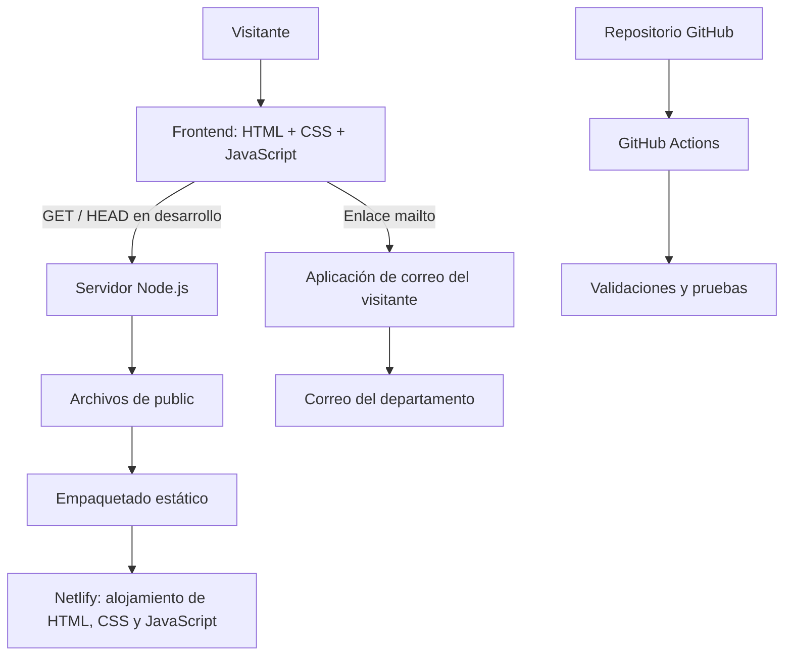
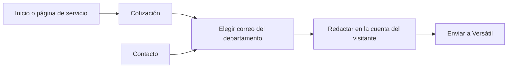

# Arquitectura de la página de Versátil

## Esquema general

Existen dos formas de servir el mismo frontend: el servidor Node.js del proyecto y un alojamiento estático compatible, como Netlify. El despliegue estático no ejecuta Node.js: utiliza directamente las páginas y los recursos preparados. No necesita una función de servidor para los correos.

## Frontend

- Diez documentos HTML independientes en `public`, con rutas por directorio e index.html.
- `public/assets/styles.css`: paleta, tipografía, composición, componentes, animaciones y puntos de adaptación.
- `public/assets/app.js`: menú móvil, resaltado del departamento en Cotización y entradas al desplazarse.
- `public/assets/versatil-symbol.svg`: V dorada transparente.
- `public/assets/industrial.svg`: ilustración conceptual del inicio; no es una fotografía de inventario.

El navegador trabaja con recursos del mismo origen. El menú conserva navegación visible cuando JavaScript no está disponible. No se incorporaron frameworks, analítica de terceros, formularios ni peticiones de envío.

## Backend Node.js

`server.js` utiliza módulos nativos de Node.js y no tiene dependencias de producción. Se encarga de:

1. Servir las diez rutas declaradas y los tipos de archivo permitidos.
2. Admitir GET y HEAD; rechazar otros métodos con 405.
3. Comprobar rutas decodificadas, caracteres de control y resolución real de archivos.
4. Evitar que un enlace simbólico exponga archivos fuera de public.
5. Añadir CSP, nosniff, política de referente y restricciones de permisos.
6. Exponer `GET /api/health` con `{ "status": "ok", "contact": "email" }`.
7. Informar de forma controlada puertos inválidos u ocupados.

El proceso no lee .env, no se conecta a SMTP y no procesa ni almacena solicitudes. Una petición POST a `/api/cotizaciones` se rechaza; no es una API comercial activa. La recepción y respuesta ocurren en los buzones de la empresa.

## Rutas y flujo comercial

La especificación completa de páginas está en [ESQUEMA_DEL_SITIO.md](ESQUEMA_DEL_SITIO.md).

El parámetro `departamento=consultoria`, `departamento=comercializacion` o `departamento=renta` resalta el área correspondiente en Cotización. Los valores no reconocidos no generan contenido HTML ni seleccionan un área. Sin JavaScript, los tres correos siguen disponibles.

## Entregas

| Comando | Salida | Uso |
| --- | --- | --- |
| `npm run build` | `dist/` | Entrega con servidor Node.js: páginas, recursos, server.js y package.json mínimo. Se inicia allí con `node server.js`. |
| `npm run build:static` | `dist-static/` | Entrega estática con index.html en la raíz y configuración de rutas/cabeceras de Netlify. |

Los directorios generados están excluidos de Git. Se versionan el código fuente, los scripts de construcción, las pruebas y las plantillas de despliegue. Las entregas no incluyen credenciales, node_modules, configuración del editor ni el PDF interno de referencia.

## Desarrollo y pruebas

- Node.js 24 o superior; comprobaciones remotas configuradas para Node 24 y 26.
- Dependencias de desarrollo fijadas en package-lock.json: Playwright, axe-core y html-validate.
- `npm ci` reproduce las versiones y comprueba su integridad.
- `npm run validate` revisa JavaScript, JSON, HTML, pruebas, build y arranque de la entrega aislada.
- `npm run test:ui` revisa las diez páginas, accesibilidad automatizada, menú, correos y adaptación a cuatro anchos.
- `.github/workflows/validate.yml` ejecuta servidor y entregas en Ubuntu/Windows y navegador en Chromium sobre Ubuntu.

Los resultados previos y sus límites están en [AUDITORIA_ESTRICTA.md](AUDITORIA_ESTRICTA.md). Una prueba automatizada aprobada no sustituye la revisión legal ni una certificación manual de accesibilidad.

## Configuración y límites

El puerto predeterminado es 3000 y la interfaz predeterminada es 127.0.0.1. HOST y PORT pueden definirse en el entorno del proceso. No se necesitan claves para los correos mailto.

El contenido compartido entre las páginas es estático y repetido: cabecera, menú y pie deben mantenerse coherentes al editar. Este diseño permite una entrega simple sin compilador de plantillas; las pruebas verifican enlaces y estructura.

La política actual mantiene noindex para el sitio de revisión. La versión pública definitiva requiere revisar dominio, contenido y aviso aprobado antes de cambiar las políticas de indexación. Agregar una configuración de Netlify al repositorio no crea ni actualiza una publicación por sí mismo.
