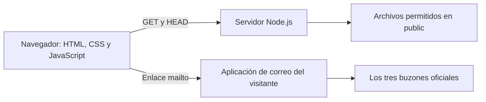

# Auditoría estricta de Versátil

Fecha: 10 de noviembre de 2026.

## Dictamen

**La versión corregida pasa la validación técnica local y la validación remota de GitHub del frontend y del servidor Node.js.** Al iniciar la auditoría, main sólo contenía README.md; el código auditado ya está versionado en una rama de revisión con pull request en borrador y cinco trabajos de GitHub Actions aprobados. No se afirma aprobación para producción ni se certifica la copia instalada en la computadora del usuario, a la que esta sesión no tiene acceso directo.

Se corrigieron los defectos reproducibles detectados. La versión auditada se entrega con pruebas y un workflow que ya ejecutó la validación en GitHub. No se publicó el sitio, no se alteró main y no se enviaron mensajes de correo.

## Arquitectura revisada



- Frontend nativo, con diez páginas, estilos y comportamiento compartidos. No requiere React, compilación de TypeScript, bundler ni servicios de terceros.
- Backend Node.js con módulos nativos, lista explícita de páginas y tipos de recursos, resolución de rutas y cabeceras de seguridad. No tiene dependencias de producción.
- El único contacto comercial es correo: nom@versatilconsulting.com.mx, administracion@versatilconsulting.com.mx y maquinaria@versatilconsulting.com.mx.
- No hay formularios, recepción de solicitudes, SMTP, base de datos ni contraseñas de correo. El servidor no carga .env.
- El build genera una entrega autónoma en dist con 16 archivos. No incluye herramientas de desarrollo, credenciales, historial Git ni node_modules.

## Hallazgos y estado

| ID | Severidad | Hallazgo | Resultado |
| --- | --- | --- | --- |
| GH-01 | Alta | GitHub no contiene el código desarrollado. Todos los archivos de aplicación estaban fuera del commit inicial. | Resuelto en la rama de revisión y PR #1; main se conserva sin cambios. |
| GH-02 | Alta | No hay GitHub Actions ni checks ejecutados en el commit remoto. | Workflow validado con actionlint y ejecutado en GitHub; cinco trabajos aprobados. |
| UI-01 | Media | Las etiquetas pequeñas de área tenían contraste 4.05:1 sobre blanco, inferior al mínimo 4.5:1. | Corregido con acento de texto más oscuro; axe no detecta infracciones en la versión corregida. |
| UI-02 | Media | El aria-label del logotipo omitía parte de su texto visible, afectando el nombre accesible y comandos por voz. | Corregido: el nombre accesible se obtiene del texto visible. |
| UI-03 | Media | El menú móvil permanecía oculto si JavaScript estaba desactivado. | Corregido con mejora progresiva; navegación visible sin JavaScript. |
| SRV-01 | Media, condicionada | La comprobación original de rutas era sólo léxica: un enlace simbólico local en assets podía apuntar fuera del directorio público. | Corregido con realpath, límite al directorio público y tipos de recurso permitidos; prueba de regresión aprobada. |
| SRV-02 | Baja | Una ruta con carácter de control podía terminar en un error 500. | Corregido: devuelve 400 sin exponer información interna. |
| SRV-03 | Baja | Puerto inválido u ocupado provocaba errores de arranque sin explicación controlada. | Corregido: salida no exitosa y mensaje útil; probado mediante procesos reales. |
| HTML-01 | Baja, estilo | Los diez DOCTYPE usaban minúsculas y el validador recomendado exigía mayúsculas. Los navegadores sí los admitían. | Normalizado y validación HTML sin errores. |
| ENT-01 | Media | No había una entrega generada y probada de forma reproducible. | Build y smoke test aislado incorporados y aprobados. |

Las primeras pruebas de navegador detectaron las infracciones de contraste y nombre accesible, además de la navegación sin JavaScript. Se corrigió también un selector del propio test que dejaba de localizar el botón cuando cambiaba de Menú a Cerrar; eso no era un fallo del sitio. Dos comprobaciones nuevas de pruebas se ajustaron para comparar MIME literalmente y pasar una ruta de archivo al proceso Node. No se desactivaron reglas ni se ocultaron infracciones para conseguir resultados positivos.

## Evidencia ejecutada

| Comprobación | Resultado |
| --- | --- |
| Node.js 24.22.1 en Linux x64: npm run validate | Aprobada. |
| Node.js 26.13.0 en Linux x64: npm run validate | Aprobada. Binario oficial verificado por SHA-256 de nodejs.org. |
| Sintaxis JavaScript | 10 archivos revisados con node --check. |
| JSON de paquete, lockfile y VS Code | 7 archivos analizados correctamente. |
| HTML recomendado | Diez páginas, sin errores tras las correcciones. |
| Pruebas de servidor y contenido | 12 aprobadas con cada versión de Node; cero fallos y cero omitidas en el entorno local. |
| Build | 16 archivos generados, sin dependencias de producción. |
| Entrega aislada | Arranque, salud, páginas y recursos verificados en carpeta temporal con espacios y sin instalar dependencias. |
| Chromium / Playwright | 56 pruebas aprobadas, cero fallos y cero reintentos. |
| Tamaños de pantalla | 1440, 768, 390 y 320 píxeles. |
| Accesibilidad automatizada | Diez páginas por tamaño, usando reglas WCAG 2 A/AA, 2.1 A/AA y 2.2 AA de axe-core; sin infracciones detectadas. |
| Comportamiento | Menú por teclado y Escape, foco, movimiento reducido, contenido y navegación sin JavaScript, correos y departamento seleccionado. |
| Navegación y recursos | Enlaces internos y recursos devuelven 200, imágenes cargadas, un H1 por página y sin desbordamiento horizontal. |
| Metadatos | Diez títulos y descripciones únicos; fragmentos internos resueltos. |
| Seguridad HTTP | GET/HEAD, rechazo de otros métodos, archivos privados y traversal bloqueados, CSP, MIME y nosniff verificados. |
| npm audit --audit-level=high | Cero vulnerabilidades reportadas, incluidas las herramientas de desarrollo. |
| Configuración local | .env, .env.local, node_modules, dist y resultados de pruebas están excluidos de Git. No se leyeron valores privados. |

La validación automatizada de accesibilidad no equivale a una certificación WCAG ni sustituye pruebas manuales con lectores de pantalla. El navegador probado es Chromium. En GitHub Actions también se ejecutaron las suites en Linux y Windows con Node 24 y 26: doce pruebas por combinación, cero fallos y cero omitidas. La validación de navegador en GitHub se ejecutó en Chromium sobre Ubuntu.

## Comprobación de GitHub al iniciar la auditoría

Repositorio privado verificado mediante la autenticación existente de la plataforma:

https://github.com/aaroneserrano7-del/Cunsultoria-y-servicios-industriales-Versatil-

- Rama principal: main.
- HEAD remoto: `2e869f2b08556d1b8374265ecf33ed440fef5fab`.
- Árbol remoto inspeccionado completamente: sólo `README.md`; respuesta no truncada.
- GitHub Actions: cero ejecuciones.
- Check runs: cero.
- Estados de commit: cero; el estado combinado pendiente no acredita validación.

Se incorporó `.github/workflows/validate.yml` para push, pull request y ejecución manual, con:

- Matriz de Node 24 y 26 en Ubuntu y Windows.
- Instalación desde lockfile, sintaxis, HTML, tests, build y prueba de la entrega.
- Auditoría de dependencias.
- Chromium, axe y cuatro tamaños de pantalla.
- Permisos mínimos de lectura, sin despliegue ni secretos de correo.
- Acciones oficiales fijadas a referencias SHA consultadas en sus repositorios.

## Cierre de la validación remota

El usuario autorizó expresamente crear una rama y un pull request de revisión, sin fusionar ni desplegar.

- Rama: `audit/versatil-validacion-2026-11-10`.
- Pull request en borrador: https://github.com/aaroneserrano7-del/Cunsultoria-y-servicios-industriales-Versatil-/pull/1
- Primera ejecución aprobada: https://github.com/aaroneserrano7-del/Cunsultoria-y-servicios-industriales-Versatil-/actions/runs/42857762153
- Commit de código validado en esa ejecución: `02d1a360011018bf3097e8120bbde64247674748`.
- Cinco trabajos aprobados: Node 24/Ubuntu, Node 26/Ubuntu, Node 24/Windows, Node 26/Windows y Chromium/accesibilidad/responsive.
- Los registros de los cuatro trabajos de Node confirman doce pruebas aprobadas, cero fallos y cero omitidas, además del build y la entrega aislada.
- El trabajo de navegador confirma las 56 pruebas previstas.
- El workflow fue validado con actionlint v1.7.12, descargado del proyecto oficial y verificado por SHA-256.
- Este cierre documental se incorpora después de esa primera ejecución; los cambios posteriores de documentación mantienen el código de aplicación validado. El estado actual del PR y sus ejecuciones posteriores es la referencia para el último commit de la rama.

## Límites y pendientes

1. GitHub: el código está en una rama con PR en borrador y comprobaciones aprobadas. La fusión en main queda pendiente de revisión del usuario y no se efectuó.
2. Copia del dispositivo: la auditoría cubre el código de la nube y el ZIP entregado; no demuestra que los archivos del equipo sean idénticos. Puede verificarse allí con npm run validate después de instalar la entrega auditada.
3. Contenido: falta incorporar el texto íntegro del aviso aprobado que el usuario indicó tener; no se inventó un aviso legal.
4. Publicación: el sitio permanece en desarrollo, con noindex y robots de bloqueo. Dominio, HTTPS del alojamiento y operación pública no se auditaron porque no hay un despliegue autorizado.
5. Correo: se validaron los enlaces a las tres direcciones. No se enviaron correos reales ni se verificó recepción en esos buzones. mailto depende de la aplicación o servicio de correo del visitante.
6. Versionado: los archivos de aplicación, las correcciones y las pruebas ya están incorporados a Git en la rama de revisión. No se reinició ni sobrescribió main.

## Repetir la validación

Desde la carpeta con package.json:

```sh
npm ci
npm run validate
npx --no-install playwright install chromium
npm run test:ui
```

En PowerShell pueden utilizarse `npm.cmd` y `npx.cmd`. En un entorno con Chromium ya instalado se puede definir CHROMIUM_PATH apuntando a ese ejecutable. No se deben desactivar la validación TLS ni las comprobaciones de integridad de paquetes o binarios.

La carpeta dist se inicia con `node server.js` desde su raíz. Las dependencias de pruebas sólo se necesitan para desarrollo y auditoría.
