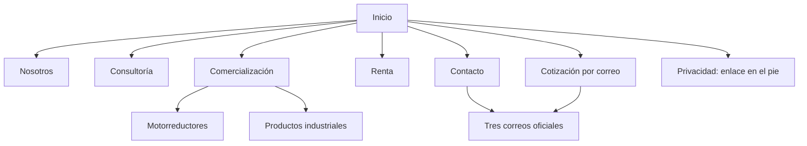

# Esquema completo del sitio

## Mapa de información

## Páginas implementadas

| Ruta | Archivo | Objetivo y bloques |
| --- | --- | --- |
| `/` | `public/index.html` | Titular, ilustración conceptual, accesos a las tres áreas, especialidades, proceso y cierre de contacto. |
| `/nosotros` | `public/nosotros/index.html` | Presentación institucional, visión conjunta de la oferta y acceso a los departamentos. |
| `/consultoria` | `public/consultoria/index.html` | Orientación en casos NOM para importación, información útil para revisar el caso y correo del área. |
| `/comercializacion` | `public/comercializacion/index.html` | Entrada al departamento y acceso a sus dos categorías. |
| `/comercializacion/motorreductores` | `public/comercializacion/motorreductores/index.html` | Información técnica que ayuda a consultar transmisión industrial y vínculo a cotización. |
| `/comercializacion/productos-industriales` | `public/comercializacion/productos-industriales/index.html` | Identificación del producto, aplicación y cantidad para orientar la consulta. |
| `/renta` | `public/renta/index.html` | Necesidad de maquinaria, ubicación, periodo y logística; contacto sujeto a confirmación de equipo. |
| `/contacto` | `public/contacto/index.html` | Tres tarjetas con correos completos y enlaces mailto. |
| `/cotizar` | `public/cotizar/index.html` | Acceso a los mismos tres correos; resalta el área que origina la consulta. |
| `/aviso-de-privacidad` | `public/aviso-de-privacidad/index.html` | Explica el contacto por correo y señala el texto íntegro del aviso pendiente de incorporar. |

## Navegación

Cabecera: marca con enlace a Inicio, Inicio, Nosotros, Consultoría, Comercialización, Renta, Contacto y Cotización.

Pie: marca, enlaces a los departamentos, los tres correos y Privacidad. Las categorías comerciales tienen páginas propias, accesibles desde Comercialización. El sitio no contiene inventario público, carrito, cuentas, formularios ni panel administrativo.

## Recorrido de una solicitud

1. El visitante identifica su necesidad en Inicio o en una página de servicio.
2. El botón Cotización conduce a `/cotizar`; las páginas de área pueden añadir el parámetro `departamento`.
3. El visitante elige la dirección adecuada y abre su aplicación de correo, o copia la dirección en su servicio habitual.
4. Redacta y envía desde su propia cuenta.
5. La atención posterior ocurre en el buzón correspondiente de Versátil.

No hay un mensaje de recepción automática en la web ni un folio generado por servidor. El sitio no puede afirmar que un correo se recibió sólo porque se pulsó el enlace.

## Parámetros

| Consulta | Resultado |
| --- | --- |
| `?departamento=consultoria` | Resalta Consultoría / NOM. |
| `?departamento=comercializacion` | Resalta Comercialización. |
| `?departamento=renta` | Resalta Renta de maquinaria. |
| Valor distinto | Mantiene los tres correos sin área resaltada. |

Los enlaces de las categorías pueden conservar información de contexto en la URL; el único comportamiento de selección implementado es el departamento. Los parámetros no determinan un destinatario de backend porque no existe envío por servidor.

## Evolución sujeta a contenido aprobado

El PDF de referencia propone fichas de productos y maquinaria, marcas, casos y contenidos NOM detallados. Esas páginas no forman parte de las diez rutas actuales. Se incorporarán únicamente cuando existan datos y derechos de uso confirmados, y mediante una nueva decisión de alcance.
